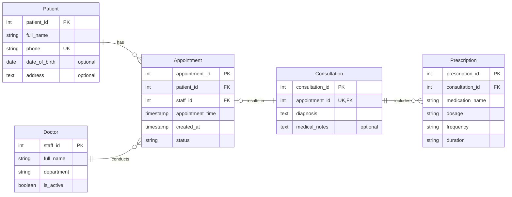

# Clinic Management System Database Design ER Diagram

## Database Design Explanation

### Keys and Constraints Explained
* **PK (Primary Key):** A unique identifier for every individual record within a table. For example, `patient_id` uniquely identifies each patient in the `Patient` table so no two patients share the same ID.
* **FK (Foreign Key):** A field that links a record in one table to the primary key of another table, establishing a relationship. For example, `patient_id` in the `Appointment` table links an appointment back to the specific patient record.
* **UK (Unique Key):** A constraint ensuring that all values in a column are distinct, preventing duplicate entries. For example, the `phone` field in the `Patient` table is marked UK to ensure two patients do not register with the exact same phone number.

### Relationship Symbols Explained
* **`||` (Exactly One):** Indicates mandatory participation where a record must relate to exactly one record on the other side. For example, each `Appointment` belongs to exactly one `Patient`.
* **`o|` (Zero or One):** Indicates optional participation where a record may relate to zero or at most one record. For example, an `Appointment` can have zero or one `Consultation` (if it is still scheduled or cancelled, it has no consultation yet).
* **`o{` (Zero or Many):** Indicates that a record can be associated with zero, one, or multiple records. For example, a `Patient` can have zero or many `Appointment` records over time.

### Optional Fields
The following fields are optional and are not required when creating a record:
* `date_of_birth` and `address` in the `Patient` table.
* `medical_notes` in the `Consultation` table.

### Business Rules Requiring Additional Constraints or Logic
While foreign keys and unique constraints handle structural integrity, several business rules require database triggers or application-level transaction logic:
1. **Active Doctor Check:** When scheduling an appointment, application logic or a trigger verifies that the assigned doctor's `is_active` status is true.
2. **Appointment Conflict Prevention:** Unique constraints on `(staff_id, appointment_time)` and `(patient_id, appointment_time)` prevent double-booking for both doctors and patients.
3. **Appointment Time Validation:** A `CHECK` constraint ensures that `appointment_time > created_at`.
4. **Completed Appointment Status:** A trigger ensures that a `Consultation` can only be recorded for an `Appointment` whose status is explicitly marked as completed.